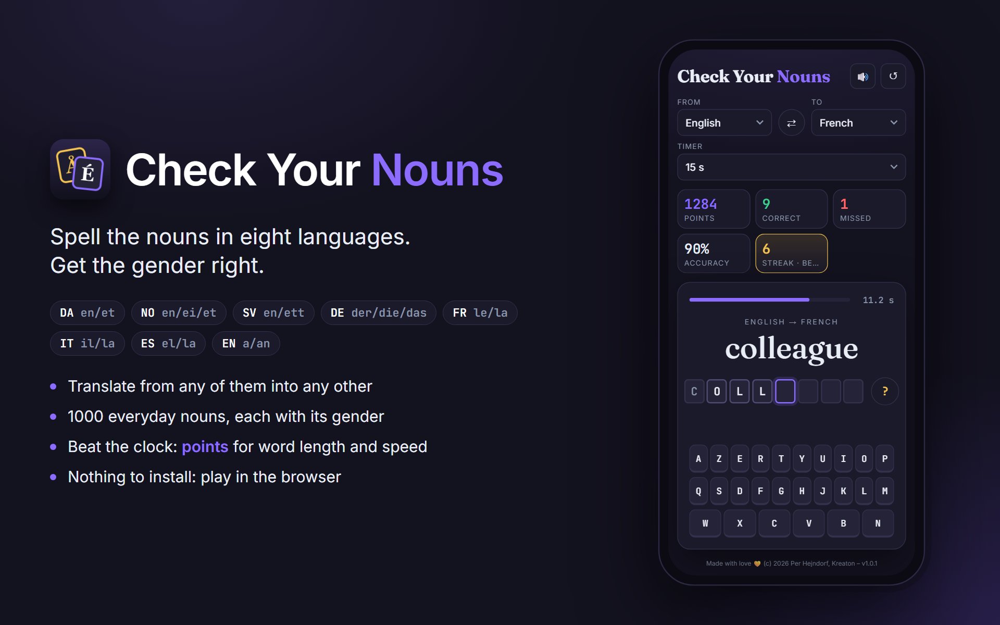

# Check Your Nouns

[](https://kreaton.github.io/CheckYourNouns/)
[](LICENSE)




**A spelling game for nouns and their genders in eight European languages.**

**Play it: <https://kreaton.github.io/CheckYourNouns/>**

The sibling of [Check Your Danish](https://github.com/kreaton/CheckYourDanish): the same game, but
you pick the language to translate **from** and **to**: Danish, English, German, French, Italian,
Spanish, Swedish or Norwegian.

A noun is shown in the "from" language with one box per letter of the word in the "to" language,
the first letter already filled in. Type the rest from left to right on the built-in keyboard (or
your own), then choose the gender. The choices follow the target language:

| Language  | Choices | Notes |
|-----------|---------|-------|
| Danish    | en · et | |
| Norwegian | en · ei · et | Feminine nouns also accept *en*, as Bokmål allows. |
| Swedish   | en · ett | |
| German    | der · die · das | Keyboard has Ä, Ö, Ü and ß. |
| French    | le · la | The answer shows the real article (*l'eau*). |
| Italian   | il · la | The answer shows the real article (*lo zaino*, *l'acqua*). |
| Spanish   | el · la | The answer shows the real article (*el agua*). |
| English   | a · an | No gender, so it's the indefinite article instead. |

- A wrong letter plays a short error sound; keep going until it's right.
- `?` reveals the next letter, which you then still have to type.
- A word spelled and gendered without any mistakes counts as **correct** and plays a success
  sound. A wrong letter, a wrong gender or using `?` counts it as **missed**.
- Accents that are not their own key (é, à, ç, ô …) are typed without them; letters that are
  (Æ, Ø, Å, Ä, Ö, Ü, ß, Ñ) must be typed. French Œ is spelled OE.
- The score, accuracy and streak are kept in the browser for each language pair; ↺ resets them.

### Timer

Pick **Off** or 5–20 seconds per word under *Timer* (a new setting starts with the next word). A
bar counts down, turning red with a tick for each of the last three seconds. When time runs out,
the word is filled in with its gender, a failure sound plays, and the word counts as **missed**;
the game waits for *Next word* (or `Enter`) before going on.

### Points

A word answered without mistakes scores **10 points per letter**, plus a **speed bonus** of up to
as much again: the bonus is full at 0 seconds and shrinks linearly to nothing at the time limit
(without a timer, at 1 second per letter plus 3 seconds). Missed words score nothing. The
result shows the points and the time taken, e.g. `+217 points · 0.6 s` for *Staubsauger*
(110 + 107 with a 20-second timer).

Keyboard shortcuts: letters, `?` for a hint, `1`/`2`/`3` for the gender, and `Enter` to start or go
to the next word.

## The word list

The 1000 nouns from Check Your Danish live in `CheckYourNouns/wwwroot/nouns.json`, one noun per
line in every language, each written as `gender word`:

```json
{"da": "en mand", "en": "a man", "de": "der Mann", "fr": "m homme", "it": "m uomo",
 "es": "m hombre", "sv": "en man", "no": "en mann", "also": {"en": ["husband"]}}
```

| Gender codes | |
|--------------|---|
| `da` | `en`, `et` |
| `no` | `en`, `ei`, `et` |
| `sv` | `en`, `ett` |
| `de` | `der`, `die`, `das` |
| `fr`, `it`, `es` | `m`, `f` (the article is worked out from the word) |
| `en` | `a`, `an` |

`label` gives a fuller prompt than the word (`"cousin (male)"`), and `also` lists other
translations shown under the prompt. Words whose letters can't be typed on the target keyboard
are skipped for that pair. Words come in random order, and every word is shown once before any
repeats.

## Run

```bash
dotnet run --project CheckYourNouns
```

The app then runs at http://localhost:5149.

## Icons

The app icon (iOS home screen, Windows/Android install via the web app manifest, and the browser
favicon) is drawn by a script into `CheckYourNouns/wwwroot/icons` and `wwwroot/favicon.ico`:

```powershell
powershell -File tools\make-icons.ps1
```

The README banner (`images/banner.png`) is `tools/banner.html` rendered by headless Edge:

```powershell
powershell -File tools\make-banner.ps1
```

## Version

`Directory.Build.props` sets the version: Major.Minor by hand, and the patch is the GitHub Actions
run number (0 for local builds). The footer shows the version, build time and git commit.

## Deploy

`.github/workflows/deploy.yml` publishes to [GitHub Pages](https://kreaton.github.io/CheckYourNouns/) on every
push to `main` (or manually from the Actions tab).

The page uses a relative `<base href="./">`, so it works in any folder.

## License

[MIT](LICENSE) © 2026 Per Hejndorf.
